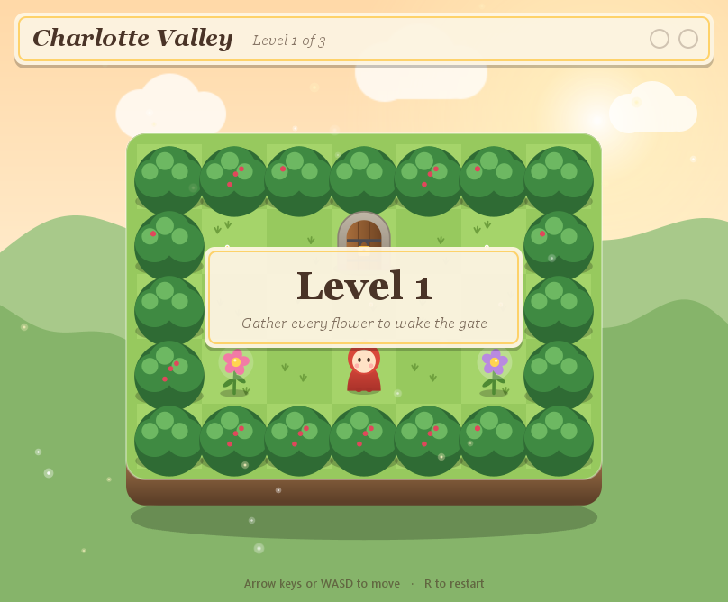
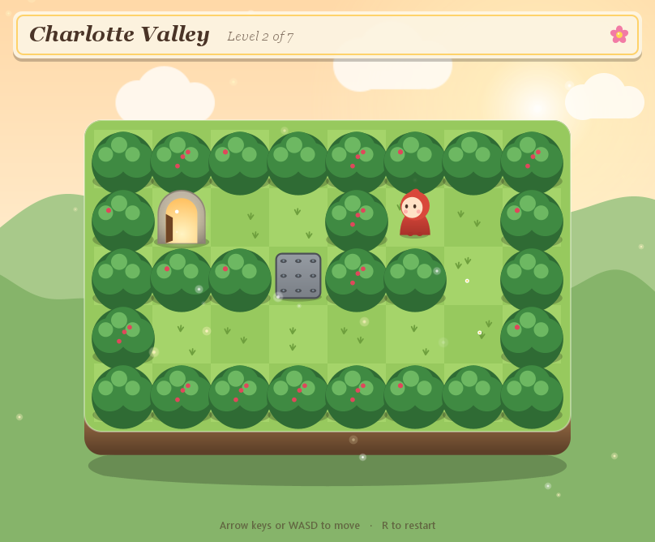
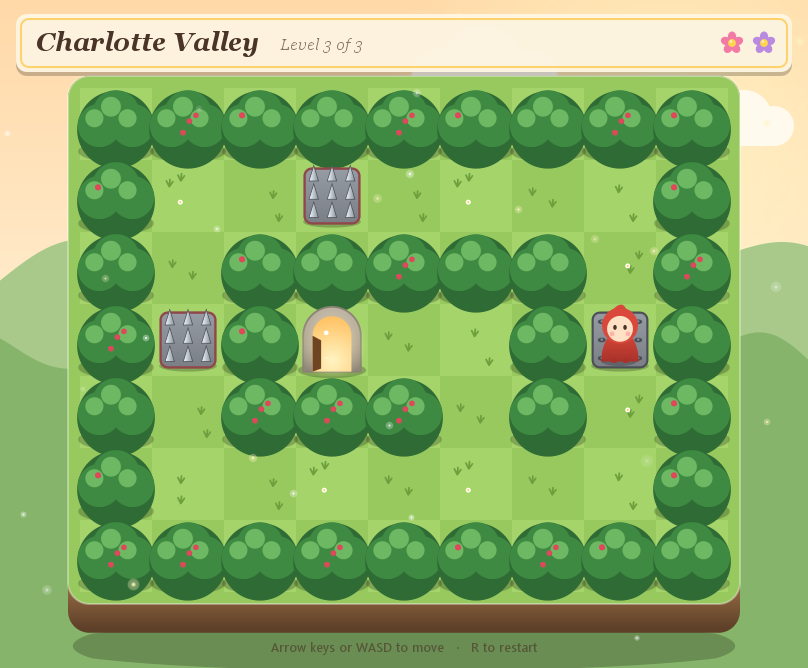

# Charlotte Valley

A small grid puzzle game written in Java with Swing.

Help Charlotte pick every flower in the valley, then walk through the gate to the next level. Be careful: a spike trap rises after you step off it, so you can only cross each one once.

The project is a study exercise in design patterns: Factory, Command, Observer, State and Adapter.



| Level 2: the gate is open | Level 3: standing on a spike |
|---|---|
|  |  |

## How to play

- Pick up all the flowers. The counter in the top right shows how many you have.
- When the last flower is picked, the gate opens.
- Walk into the open gate to finish the level.
- Hedges block your way.
- A spike is safe while it is down. When you step off it, it rises. Stepping on a raised spike sends you back to the start of the level.

## Controls

| Key | Action |
|---|---|
| Arrow keys or W A S D | Move |
| R | Restart the level |

## Run it

You need Java 25.

```
./gradlew run
```

On Windows use `gradlew.bat run`. Run the tests with `./gradlew test`.

## Design patterns

| Pattern | Where | What it does |
|---|---|---|
| Factory | `LevelFactory` | Builds a level from a text grid. `W` hedge, `F` flower, `S` spike, `E` exit, `P` player, `O` grass. |
| Command | `Command`, `MoveCommand` | Each key press becomes a move command that the `LevelManager` runs. |
| Observer | `LevelListener`, `LevelManager` | The level sends events (flower picked, player died, level done). The manager, the screen and the sounds listen to them. |
| State | `SpikeTile` + `LoweredSpikeState` / `RaisedSpikeState`, `ExitTile` + `LockedDoorState` / `OpenDoorState` | Spikes and the gate change their behaviour and their picture by switching state. |
| Adapter | `SoundPlayer`, `ClipSoundAdapter` | The game asks for a sound by event. The adapter turns that into Java's `Clip` audio API. |

## Adding a level

Levels live in `Levels.java` as text grids. Every level needs one `P`, one `E` and at least one `F`:

```java
new String[]{
        "WWWWWWW",
        "WOOEOOW",
        "WOOOOOW",
        "WFOPOFW",
        "WWWWWWW"
}
```

## Project layout

```
src/main/java/dev/ua/ikeepcalm/
  CharlotteValley.java       starts the game
  level/                     level model, factory, manager, level list
  level/source/              enums: directions and game events
  level/type/                interfaces: level listener, spike and door states
  level/tile/                hedge, grass, flower, spike and exit tiles
  level/state/               spike and door state implementations
  move/                      move command
  move/type/                 command interface
  sound/                     sound adapter
  sound/type/                sound player interface
  ui/                        game window, HUD, player sprite, particles
  ui/source/                 particle shape enum
  render/                    sprite loading, colours
src/main/resources/
  sprites/                   PNG sprites and sprite sheets
  sounds/                    WAV sound effects
```

Animated sprites are PNG strips of square frames. Tile sprites are 108 x 108 pixels: a 72 pixel tile with 18 pixels of space around it for shadows.
